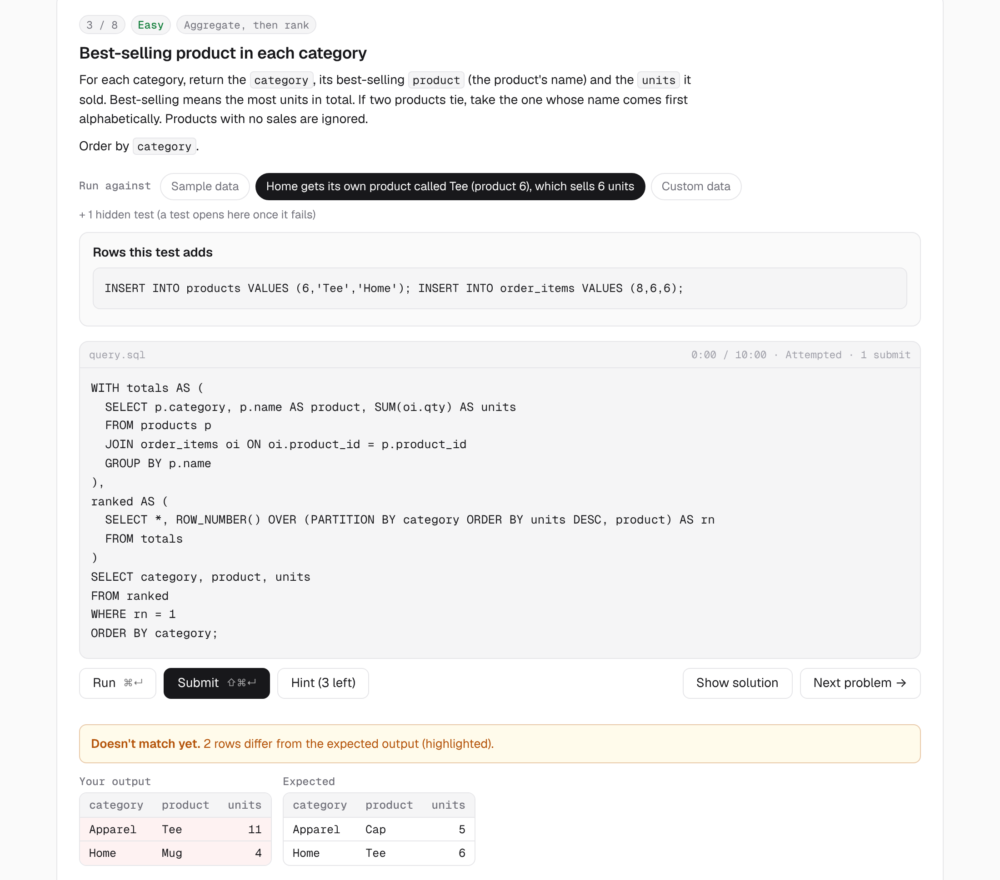
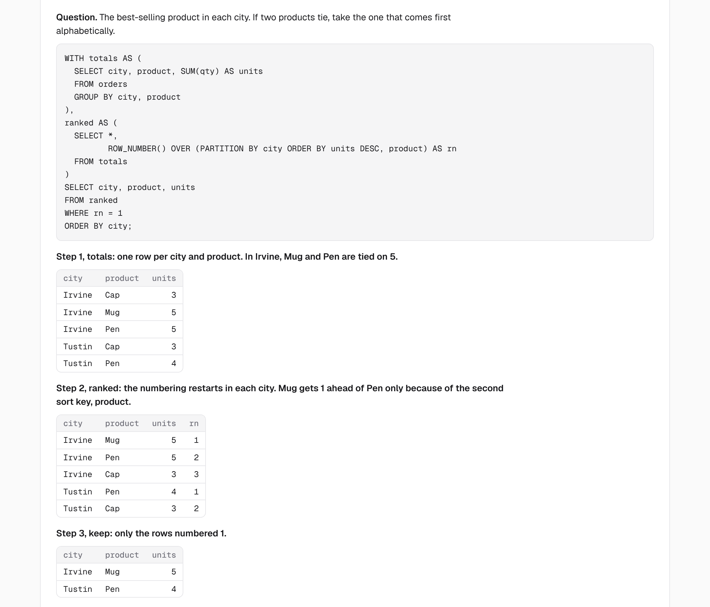
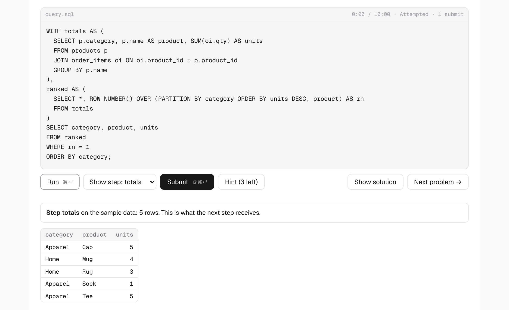

# SQL Lab

A SQL diagnostic and practice set that runs entirely in the browser. Take the diagnostic to find where your SQL breaks down, then practice those gaps with problems that go from easy to hard and are checked the way LeetCode and interviewers check.

It's built to be copied. Fork it, take the diagnostic, and add practice topics for your own gaps. An AI assistant can write most of a new topic, and the included checks catch its mistakes.

[](https://portfolio-mo.vercel.app/sql-lab)
[](https://portfolio-mo.vercel.app/sql-practice)
[](https://portfolio-mo.vercel.app/projects/sql-lab)
[](https://github.com/Mahabala-O/sql-lab/generate)

[](https://github.com/Mahabala-O/sql-lab/actions/workflows/checks.yml)



## What's inside

**Diagnostic** (`sql-lab.html`): 14 query tasks, from an anti-join warm-up to gaps-and-islands, and 11 concept checks on window functions and NULLs. It ends in a skill report across 10 areas, which you can copy (with every final query included) or download as JSON.

**Practice** (`sql-practice.html`): problems grouped by topic, Easy to Hard. Each topic starts with a lesson that runs a worked example and shows the output of every step. Solved problems stay in the list, with your solve count and best time, so you can come back and solve them again. The first topic, "Aggregate, then rank", has 8 problems and covers the pattern behind problems like *Seasonal Sales Analysis*: total, rank inside each group with tie-breaks, keep the top row.

**In every task:**

- **Run** checks your query against the selected data; **Submit** checks it against the sample data and every hidden test.
- **A hidden test that fails opens as a tab.** It shows the rows it adds and the expected output, and Run uses that data while you fix your query.
- **Custom data:** add your own rows, and the expected output is worked out for you.
- **Show one step:** if your query uses CTEs, a menu next to Run shows what any one of them returns.
- Hints in three steps, a timer with a target per level, and the reference solution with an explanation once you're done.



## How answers are checked

As strictly as an interviewer would:

- Column names and their order must match the prompt (letter case doesn't matter).
- If the prompt asks for an order, the final query needs an `ORDER BY`, even when the rows happen to come out sorted.
- Numbers are compared to 6 decimals, so a missing `ROUND` fails.

**Every requirement in every prompt has a test behind it, and that's checked automatically.** `checks/mutate.js` breaks each reference solution one requirement at a time: it removes the final `ORDER BY`, flips each sort key, drops each `ROUND`, and applies each edit listed for that task (a filter, a boundary, a tie-break, the choice of `RANK` or `DENSE_RANK`, what the query groups by). Then it fails unless some test returns a wrong result. Right now that's 134 requirements across 22 tasks, all covered.

This exists because the first version of the diagnostic let answers through that were missing an `ORDER BY` or a `ROUND`: the sample data happened to come out sorted and round. Writing tests by hand misses cases like these, so now the checks look for them.

## Use it

### Your own copy, hosted free on GitHub Pages

1. Click **Use this template** (or fork the repo).
2. In your copy, go to **Settings → Pages** and set **Source** to **GitHub Actions**.
3. Push to `main`, or run the "Deploy to GitHub Pages" workflow from the Actions tab. The site is published at `https://<you>.github.io/<repo>/`.

Any static host works: the site is the `public/` folder, with no build step.

### On your computer

Open `public/index.html` in a browser. It needs an internet connection the first time, to load the SQL engine from a CDN. Or serve the folder:

```bash
npm start
```

## Tailor it to your gaps

1. Take the diagnostic and click **Copy results** on the Report page.
2. Ask an AI assistant to read your queries and rank your gaps, then to write a practice topic for the top one. [docs/tailor-with-ai.md](docs/tailor-with-ai.md) has the prompts.
3. Add the topic to `public/sql/practice-bank.js` and run the checks. When they fail, give the output back to the assistant and ask it to fix the task.
4. Solve a couple of the problems yourself, then publish.

To write topics by hand, or to change the diagnostic, see [docs/writing-tasks.md](docs/writing-tasks.md). It covers the task format, the rules the checks enforce, and how to choose hidden tests.



## Checks

```bash
npm install
```

```bash
npm test
```

```bash
npx playwright install chromium
```

```bash
npm run e2e
```

| Check | What it does |
|---|---|
| `checks/harness.js` | Every reference solution passes its tests; every wrong answer in `checks/probes.js` fails on the test meant to catch it; every alternative correct answer passes. |
| `checks/mutate.js` | Every requirement stated in a prompt has a test behind it (see above). |
| `checks/macros.js` | The MySQL function rewriter, `ORDER BY` detection, the CTE step runner and result comparison. |
| `checks/e2e.js` | Both pages in a headless browser, at desktop and phone width. |

GitHub Actions runs all four on every push and pull request. The Pages workflow runs `npm test` before it publishes.

## How it works

- **SQLite in the browser** through [sql.js](https://github.com/sql-js/sql.js) (WebAssembly), loaded from jsDelivr. Nothing is sent anywhere; progress is saved in the browser's local storage.
- **MySQL syntax**, as on LeetCode. `YEAR`, `MONTH`, `QUARTER`, `HOUR`, `DATEDIFF`, `DATE_ADD(d, INTERVAL n DAY)`, `DATE_SUB`, `IF`, `LEFT`, `RIGHT`, `GREATEST` and `LEAST` are rewritten into native SQLite expressions before a query runs; `DATE_FORMAT`, `DAYNAME` and `MONTHNAME` are JavaScript functions. (The rewrite exists because sql.js returns every number from a JavaScript function as a float, so `CONCAT('Q', QUARTER(d))` would give `'Q2.0'`.)
- **Two differences from MySQL:** integer ÷ integer is an integer (`1/3 = 0`), so write `1.0 * a / b`; and `d + INTERVAL 1 DAY` isn't supported, so use `DATE_ADD`.
- **Expected output is never typed by hand.** Each task has a reference solution, and every test only adds or removes rows. The expected result for any data, including your custom rows, comes from running the reference solution on it.
- **Plain HTML, CSS and JavaScript**, with no framework and no build step.

```
public/
  index.html            landing page
  sql-lab.html          the diagnostic
  sql-practice.html     the practice page
  sql/core.js           engine, MySQL rewriter, answer checking, the task workspace
  sql/core.css          styles (light and dark)
  sql/lab-bank.js       diagnostic tasks and concept checks
  sql/practice-bank.js  practice topics, lessons and problems
checks/                 the checks above
docs/                   writing tasks, tailoring with AI, screenshots
```

## Credits

Built by [Mikhail Orlov](https://portfolio-mo.vercel.app). Uses [sql.js](https://github.com/sql-js/sql.js) (MIT) and [SQLite](https://sqlite.org) (public domain). Problems are original; LeetCode problems are linked as follow-up practice, not copied.

MIT licensed. See [LICENSE](LICENSE).
